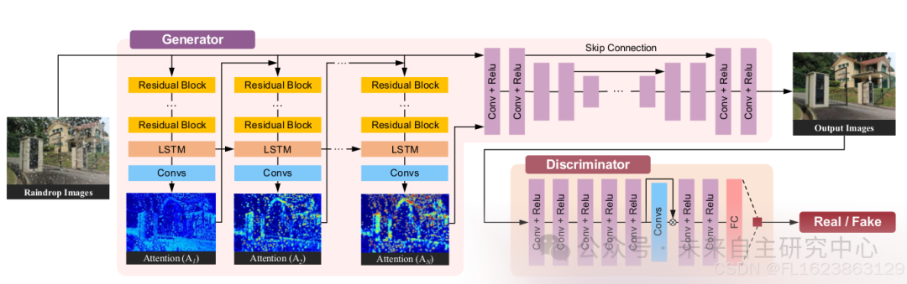
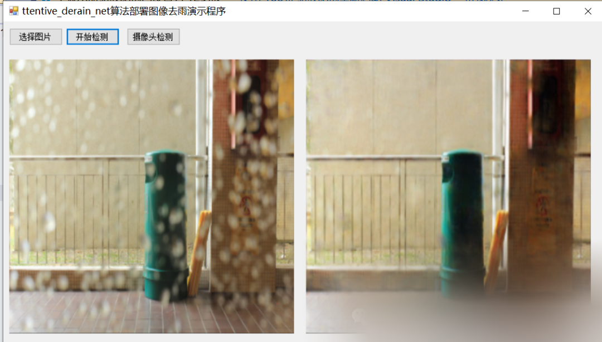

# [C#] Winform Based on Attentive Derain Net Deep Learning Algorithm for Image Rain Removal Deployment Implementation

[Training Source Code]

https://github.com/MaybeShewill-CV/attentive-gan-derainnet

[Reference Source Code]

https://github.com/hpc203/attentive-gan-derainnet-onnxruntime

[Algorithm Introduction]

The primary work is based on the CVPR 2018 paper "Attention-based Generative Adversarial Networks for Single Image Drizzle Removal", which uses TensorFlow to implement a deep convolutional generative adversarial network for image denoising tasks. You can refer to their paper for details: https://arxiv.org/abs/1711.10098. The model consists of an attention-attention recurrent network, a contextual autoencoder network, and a discriminative network. Convolutional LSTM units are used to generate attention maps, which help locate drizzles, multi-scale losses, and perceptual losses, to train the contextual autoencoder network. We would like to thank the original authors, Rui Qian.

The main network architecture is as follows:



Online experience:

 https://maybeshewill-cv.github.io/attentive_derain_net 

[Effect Display]



[Partial Implementation Code]

-
-
-
-
-
-
-
-
-
-
-
-
-
-
-
-
-
-
-
-
-
-
-
-
-
-
-
-
-
-
-
-
-
-
-
-
-
-
-
-
-
-
-
-
-
-
-
-
-
-
-
-
-
-
-
-
-
-
-
-
-
-
-
-
-
-
-
-
-
-
-
-
-
-
-
-
-
-
-
-
-
-
-
-
-
-
-
-
-
-
-
-
-

```
using System;using System.Diagnostics;using System.Windows.Forms;using OpenCvSharp; namespace FIRC{    public partial class Form1 : Form    {        Mat src = null;        AGDManager dm = new AGDManager();        public Form1()        {            InitializeComponent();        }         private void button1_Click(object sender, EventArgs e)        {            OpenFileDialog openFileDialog = new OpenFileDialog();            openFileDialog.Filter = "Figure files(*.*)|*.jpg;*.png;*.jpeg;*.bmp";            openFileDialog.RestoreDirectory = true;            openFileDialog.Multiselect = false;            if (openFileDialog.ShowDialog() == DialogResult.OK)            {                              src = Cv2.ImRead(openFileDialog.FileName);                pictureBox1.Image = OpenCvSharp.Extensions.BitmapConverter.ToBitmap(src);              }          }         private void button2_Click(object sender, EventArgs e)        {            if(pictureBox1.Image==null)            {                return;            }            var resultImg = dm.Inference(src);             pictureBox2.Image= OpenCvSharp.Extensions.BitmapConverter.ToBitmap(resultImg);           }                         private void Form1_Load(object sender, EventArgs e)        {            dm.LoadWeights(Application.StartupPath+ "\\weights\\attentive_gan_derainnet_180x320.onnx");        }         private void button3_Click(object sender, EventArgs e)        {            VideoCapture capture = new VideoCapture(0);            if (!capture.IsOpened())            {                Console.WriteLine("video not open!");                return;            }            Mat frame = new Mat();            var sw = new Stopwatch();            int fps = 0;            while (true)            {                 capture.Read(frame);                if (frame.Empty())                {                    Console.WriteLine("data is empty!");                    break;                }                sw.Start();                var resultImg = dm.Inference(frame);                sw.Stop();                fps = Convert.ToInt32(1 / sw.Elapsed.TotalSeconds);                sw.Reset();                            Cv2.PutText(resultImg, "FPS=" + fps, new OpenCvSharp.Point(30, 30), HersheyFonts.HersheyComplex, 1.0, new Scalar(255, 0, 0), 3);                // Display the result
```

[Test Environment]

vs2019

netframework4.7.2

opencvsharp==4.8.0

onnxruntime==1.16.2

[Video demonstration]

C# Winform Based Attentive Derain Net Deep Learning Algorithm for Image Rain Removal Deployment - Bilibili [Test Environment] VS2019 .NET Framework 4.7.2 OpenCVSharp == 4.8.0 ONNXRuntime == 1.16.2 For more information, please refer to: https://blog.csdn.net/FL1623863129/article/details/141310889, Video views: 2, Comments: 0, Likes: 0, Coin counts: 0, Collection numbers: 0, Share numbers: 0Video author: Future Autonomous Research Center. Biographical Introduction: Future Autonomous Research Center. Related Video: The groundbreaking AI host Neurosama and her old father Vedal officially joined Bilibili!,  Deploy the YOLOv8 TensorRT model for object detection in WinForms with the fastest detection speed using C#. Deploy the ONNX model of YOLOv10 using Python. The video has expired. Deploy the ONNX instance segmentation model of YOLOv8 using C# Winform. Tesseract-OCR Quick Training Assistant. Deploy the ONNX model of YOLOv9 on C# WinForm. Implementing real-time speech recognition project based on faster whisper and Python programming, A middle school student's homemade downloader outperforms IDM in speed? | Ghost-Downloader Demo video, OpenCvSharpImplement QR code recognition using WeChat QR code enginehttps://www.bilibili.com/video/BV1RZpCeaE21/?vd_source=989ae2b903ea1b5acebbe2c4c4a635ee


## Payment

Here is a pay link on Stripe ( https://buy.stripe.com/3cs8yP7sY87d0vu9AB ). Please contact me lonlonago@foxmail.com after funding $89, and I will send you a complete data files , thank you!


